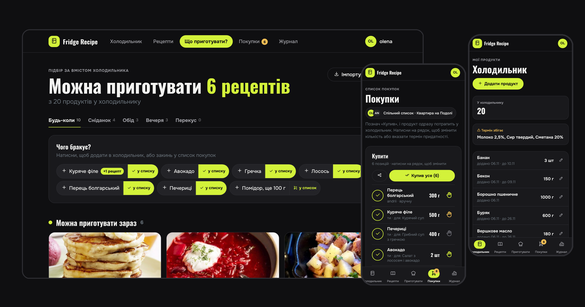
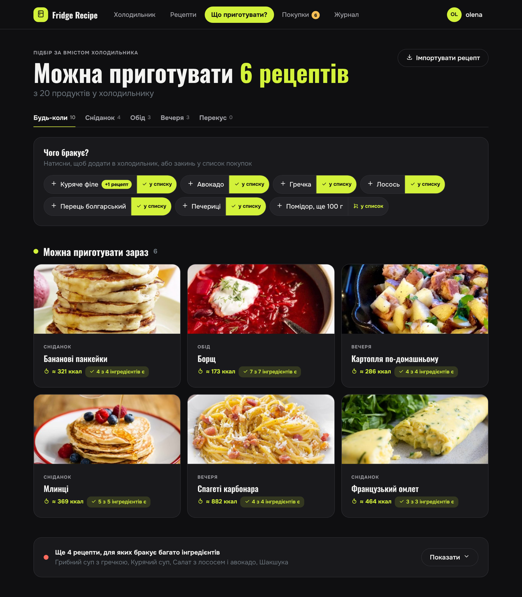
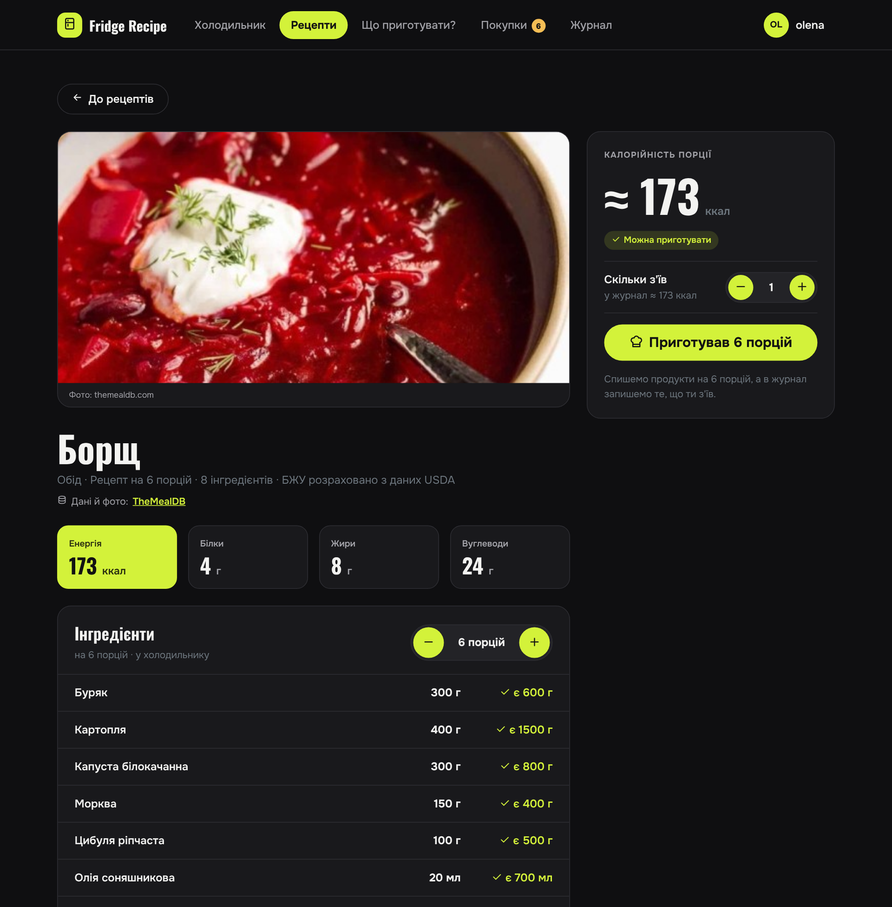
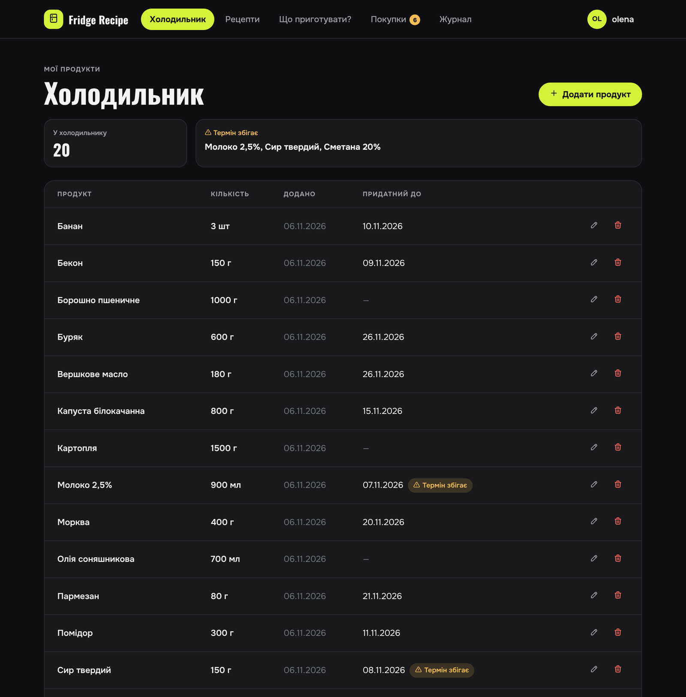
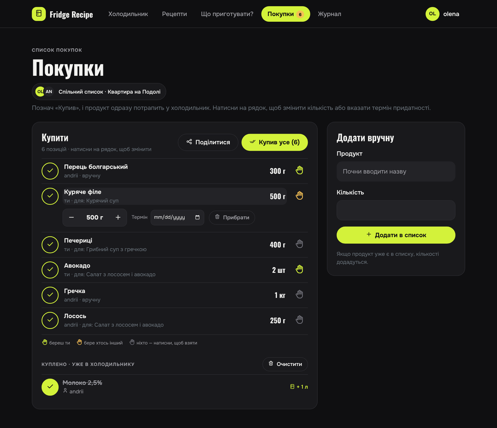
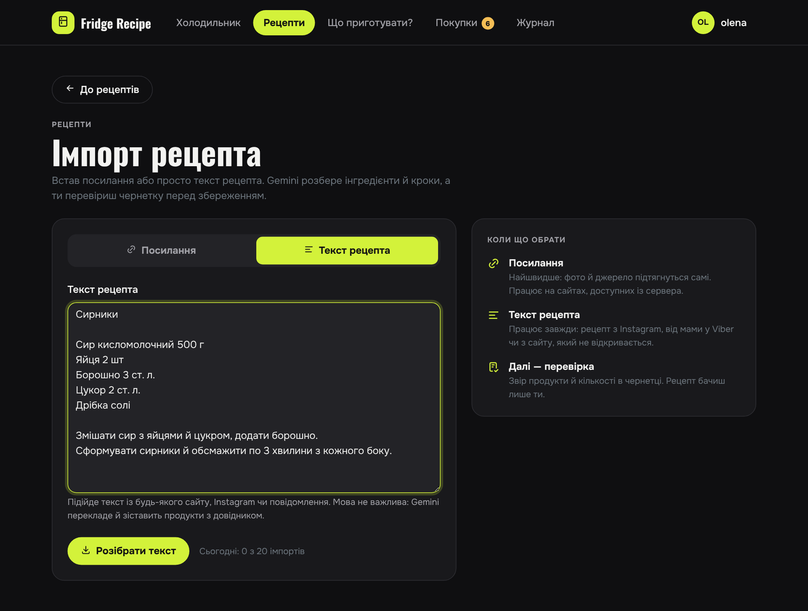
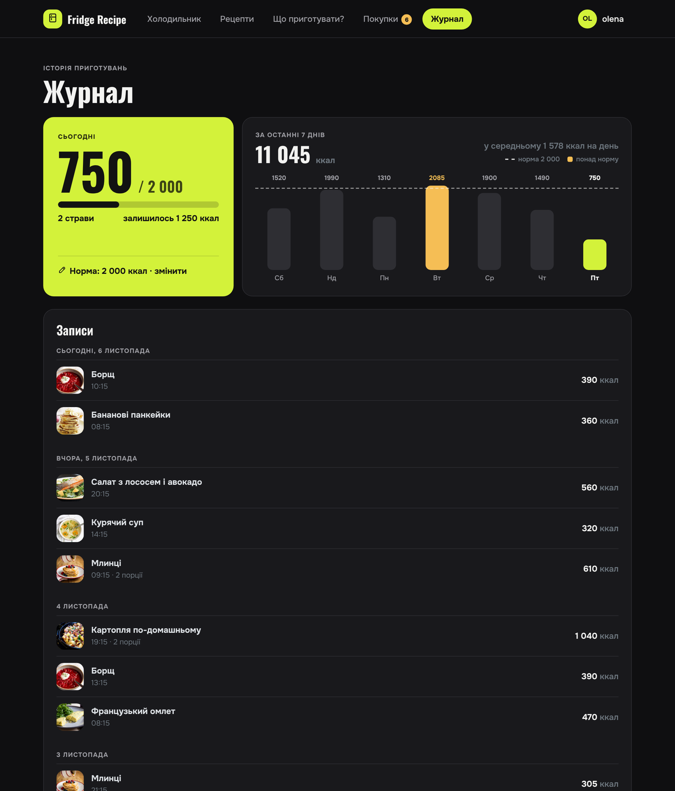

# Fridge Recipe

A Django web app that tracks what is in your fridge and suggests recipes you can cook from it. Cooking a recipe writes the ingredients off the fridge and logs the calories. Missing products go to a shopping list that a couple or a family can share. Recipes come from TheMealDB or from any page or pasted text, parsed by Gemini.

**Live demo:** https://peangqin.pythonanywhere.com



## Screenshots

The interface is in Ukrainian. All screenshots use demo data.

| What can I cook | Recipe | Fridge |
|---|---|---|
|  |  |  |

| Family shopping list | Import from text | Journal |
|---|---|---|
|  |  |  |

## Features

**Fridge**
- Products with quantity and expiry date; items about to expire get a warning.
- A catalog of about 200 shared products with calories and macros per 100 g from USDA FoodData Central, plus search with suggestions.
- You can add your own product: Gemini translates the name for the USDA query and the app fetches its nutrition.
- Adding a product that is already there with the same expiry date increases the quantity instead of creating a second row.

**Recipes and "What can I cook"**
- Each recipe gets a status: ready to cook, almost (with the list of what is missing) or missing a lot.
- The app suggests the one product that would unlock the most recipes.
- Meal categories, a servings switcher that recalculates quantities and statuses, calories and macros per serving.
- "Cooked it" writes the products off the fridge and adds the calories you ate to the journal. You can undo it for 30 minutes and get the products back with their original expiry dates.

**Import**
- Two tabs: a link or pasted text. Text covers Instagram posts, messenger messages and sites the server cannot open.
- For links the app looks for schema.org/Recipe JSON-LD first and falls back to the page text.
- Gemini returns structured JSON: Ukrainian steps, ingredients matched to the catalog, household measures converted to grams ("a cup of buckwheat" becomes 165 g).
- You review the draft before saving: pick products, fix quantities, mark "to taste". Unknown products are added from USDA.
- A shared recipe base from TheMealDB: a management command creates Ukrainian drafts, and an admin approves or rejects each one.

**Shopping list**
- Works without page reloads (HTMX): tap a row to change the quantity, set an expiry date or remove it.
- Quantities in readable units ("1.2 kg", "1 l"); repeated products merge into one row.
- "Bought" moves the product to the fridge. "Bought everything" asks for confirmation first.
- Share button: the system share sheet on a phone, copy to clipboard on a desktop.

**Family**
- One user creates a family in the profile and sends an invite code or link; up to 6 members.
- Members share the fridge, the shopping list, their own recipes and products. The journal and the calorie goal stay personal.
- A hand icon on each shopping row shows who is buying it: lime for you, orange for someone else, grey for nobody.
- On joining, private products with the same name merge into one. A member who leaves takes their own products and recipes, and the family keeps copies of the products it uses.

**Journal**
- Meals by day, calories for today against a daily goal, a 7-day chart with days over the goal highlighted.

## Stack

Python 3.14 (3.13 on the server), Django 5.2, SQLite. Bootstrap 5.3 with a custom dark theme, HTMX, Tom Select, Tabler Icons. Google Gemini (`google-genai`) for recipe parsing, USDA FoodData Central for nutrition, TheMealDB for the shared recipes, BeautifulSoup for page extraction. Tests: Django test runner and pytest-playwright. Hosting: PythonAnywhere free tier.

## Import safety

- Only `http`/`https` and public addresses (SSRF protection); the app checks every redirect again.
- The fetcher respects `robots.txt`, stops after 10 seconds and reads at most 2 MB of HTML.
- The prompt marks the page text as data, so instructions inside it have no effect.
- Daily import limits per user (`IMPORTS_PER_DAY`) and for the whole site (`IMPORTS_PER_DAY_TOTAL`).

## Installation

```bash
git clone https://github.com/GreedyClark/Fridge_Recipe_App.git
cd Fridge_Recipe_App
python -m venv venv
source venv/bin/activate        # Windows: .\venv\Scripts\Activate.ps1
pip install -r requirements.txt
cp .env.example .env            # Windows: Copy-Item .env.example .env
```

| Variable | Description |
|---|---|
| `SECRET_KEY` | Django secret key |
| `DEBUG` | `True` for development |
| `ALLOWED_HOSTS` | comma-separated, e.g. `127.0.0.1,localhost` |
| `USDA_API_KEY` | free key from https://fdc.nal.usda.gov/api-key-signup.html |
| `GEMINI_API_KEY` | key from https://aistudio.google.com; without it the import is off and the rest works |
| `GEMINI_MODEL` | main model, e.g. `gemini-3.8-flash` |
| `GEMINI_FALLBACK_MODELS` | comma-separated models to try when the main one returns 503 or 429 |
| `IMPORTS_PER_DAY` | imports per user per day, 20 by default |
| `IMPORTS_PER_DAY_TOTAL` | imports for the whole site per day, 50 by default |
| `THEMEALDB_API_KEY` | TheMealDB key; the test key `1` is enough for development |

```bash
python manage.py migrate
python manage.py createsuperuser
python manage.py import_products_from_usda    # product catalog, needs USDA_API_KEY
python manage.py loaddata initial_recipes     # 8 starter recipes
python manage.py import_themealdb --limit 10  # drafts for the shared base, needs Gemini
python manage.py runserver
```

The app runs at http://127.0.0.1:8000/, the admin at `/admin/`. TheMealDB drafts appear for the admin under "Recipes" → "Drafts".

## Deployment (PythonAnywhere)

The free tier allows Gemini and USDA but blocks cooking sites and TheMealDB, so on the server you import recipes as text.

1. In a Bash console: clone the repo, create a Python 3.13 virtualenv, `pip install -r requirements.txt`.
2. Create `.env` with `DEBUG=False`, a new `SECRET_KEY`, `ALLOWED_HOSTS=<login>.pythonanywhere.com` and `CSRF_TRUSTED_ORIGINS=https://<login>.pythonanywhere.com`.
3. Run `migrate` and `collectstatic --noinput`.
4. On the Web tab: manual configuration with Python 3.13, the virtualenv path, `DJANGO_SETTINGS_MODULE = "config.settings"` in the WSGI file, static mappings `/static/` → `staticfiles` and `/media/` → `media`, Force HTTPS, then Reload.

To update: `git pull`, `pip install -r requirements.txt`, `migrate`, `collectstatic`, Reload. Run the tests on your own machine: the free tier gives consoles 100 CPU seconds a day.

## Tests

```bash
python manage.py test
```

215 tests for models, services and views. USDA, Gemini, TheMealDB and page downloads are mocked, so the tests need no network.

Browser tests run four user flows in a real Chromium: sign up → add a product → cook → undo; import from text; "bought everything"; two members of one family sharing a fridge.

```bash
pip install -r requirements-dev.txt
playwright install chromium
pytest
pytest --headed --slowmo 500    # watch the browser
```

Gemini is mocked there too, but the pages load Bootstrap and HTMX from a CDN, so you need internet access.

## Project layout

```
accounts/          sign-up, profile, daily goal, family
  family.py        create, join, leave; merging and splitting products
fridge/            products, fridge, shopping list, USDA client
recipes/           recipes, "What can I cook", journal, import
  services.py      matching, servings, write-off and restore
  importing/       fetch, extract, gemini, themealdb, save
e2e/               pytest-playwright browser tests
templates/         Django templates
static/css/        theme
docs/              screenshots
```

## Data sources

The shared recipes and their photos come from [TheMealDB](https://www.themealdb.com/); each of those recipes links to the original. Calories and macros come from [USDA FoodData Central](https://fdc.nal.usda.gov/).
